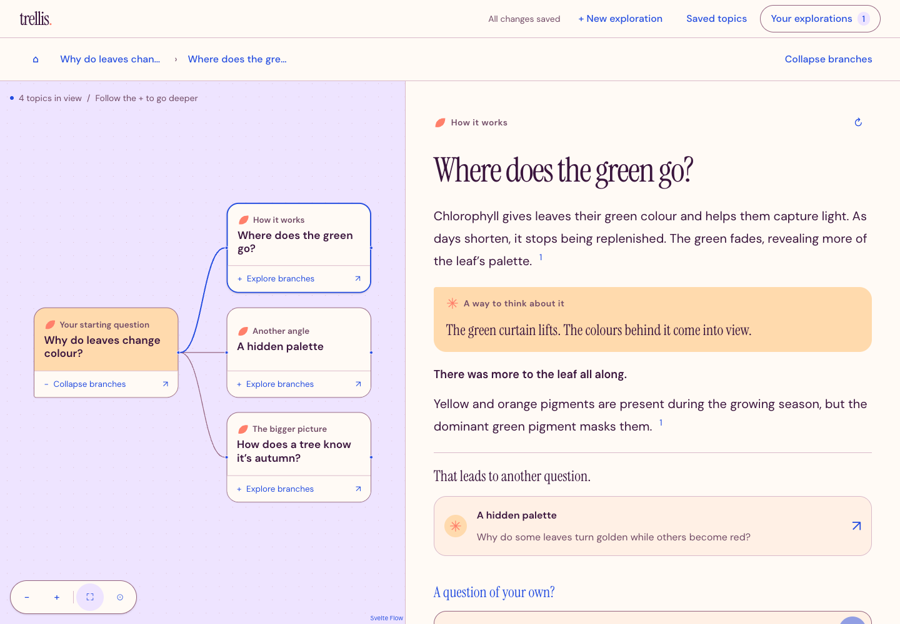
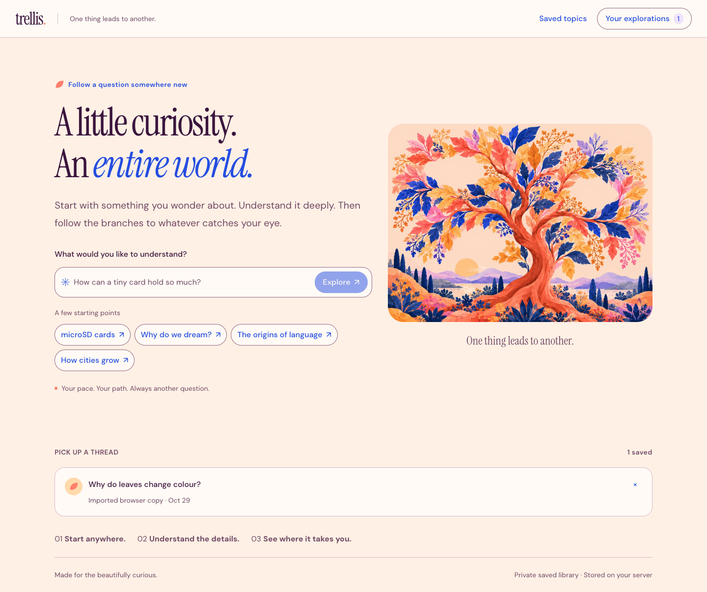

# Trellis

**One thing leads to another.**

A self-hosted research workspace for curious minds. Start with a question, read a cited explanation, and follow the branches into something unexpected.

[Explore the product page](https://leesiongchan.github.io/trellis/) · [Setup guide](docs/runbooks/rust-service.md) · [Design system](docs/design-system.md)

[](docs/images/trellis-field-guide-workspace.png)

## Follow your curiosity

- **See the connections.** Explore suggested branches or ask your own questions on a map you can pan and zoom.
- **Read with context.** Clear explanations, analogies, and citations keep the next question close.
- **Pick up the thread.** Reopen explorations, revisit saved topics, and compare answer history.
- **Make yourself at home.** Warm colour, generous type, and separate Map and Read views on phones.

Your library lives on your server, behind a private access link. Reopening saved answers makes no research calls; refreshing is an explicit action. The app needs a server connection.

[](docs/images/trellis-field-guide-home.png)

_Actual app, prewritten example content. The autumn-leaf example draws on [NOAA’s explanation of autumn colours](https://www.noaa.gov/stories/cool-autumn-weather-reveals-nature-s-true-hues)._

## Run locally

Install [mise](https://mise.jdx.dev/) and the [native build prerequisites](docs/runbooks/knowledge-storage.md#native-build-prerequisites), including a C++ compiler and libclang.

```sh
git clone https://github.com/leesiongchan/trellis.git
cd trellis
mise trust
mise install --locked node pnpm rust
mise exec -- pnpm install --frozen-lockfile --ignore-scripts
mise exec -- node api/scripts/fetch-embedding-model.ts .artifacts/embedding-model
mise exec -- pnpm build
cp .env.example .env
```

In `.env`, set:

- `APP_DATA_DIR` to an absolute private directory outside the repository.
- `APP_ACCESS_KEY` to a key generated with `openssl rand -hex 32`.
- `APP_ORIGIN` to `http://127.0.0.1:3000` for local use.
- `OPENAI_API_KEY`, `TAVILY_API_KEY`, and an available `OPENAI_MODEL` for live research. Provider usage may incur charges; empty keys support reading saved content.

Start with `mise exec -- pnpm start`, then open `http://127.0.0.1:3000/access?key=YOUR_APP_ACCESS_KEY`, replacing the placeholder with your key.

One Rust executable serves the Svelte app and an embedded SurrealDB/RocksDB library. Keep the packaged `release/` files together. For remote hosting, HTTPS, and backups, follow the [operation guide](docs/runbooks/rust-service.md) and [storage guide](docs/runbooks/knowledge-storage.md).

## Development

After the initial build, run `mise exec -- pnpm dev` for local development. Check changes with `pnpm check` and `pnpm test:unit` using the pinned tools.

[Research behaviour](docs/runbooks/research.md) · [Storage and backups](docs/runbooks/knowledge-storage.md) · [Product page source](site/)
